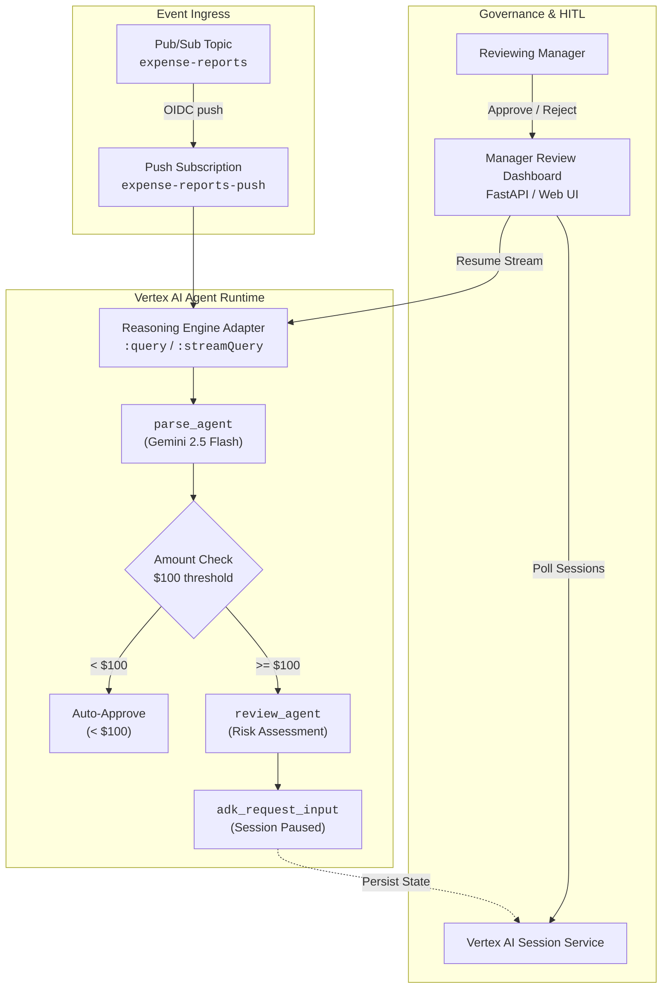

# Ambient Expense Governance Hub

An ambient expense reporting and human-in-the-loop (HITL) governance platform built on **Google Cloud Vertex AI Agent Runtime** and the **Google Agent Development Kit (ADK)**.

---

## 🏛 Architecture Overview



---

## 📁 Repository Structure

```
.
├── agent/                  # Ambient Expense Agent (ADK & Vertex AI Agent Runtime)
│   ├── app/
│   │   ├── agent.py        # Core ADK workflow (parse_agent, route_by_amount, review_agent)
│   │   ├── fast_api_app.py # FastAPI entrypoint
│   │   └── app_utils/      # Reasoning engine adapter & session wiring
│   ├── deployment/         # Terraform configurations for staging & prod
│   ├── tests/              # Unit, integration, and load tests
│   ├── pyproject.toml      # Python dependencies (managed via uv)
│   └── Dockerfile          # Container build definition
│
├── frontend/               # Manager Review Dashboard
│   ├── main.py             # FastAPI server with dynamic session polling and modern UI
│   ├── pyproject.toml      # Frontend dependencies
│   └── Dockerfile          # Cloud Run container definition
│
└── README.md
```

---

## 🚀 Getting Started

### Prerequisites

- Python 3.11+
- [`uv`](https://docs.astral.sh/uv/) package manager
- Google Cloud SDK (`gcloud`) with credentials configured:
  ```bash
  gcloud auth application-default login
  ```

---

### 1. Running the Manager Dashboard Locally

```bash
cd frontend
uv run uvicorn main:app --host 0.0.0.0 --port 8080 --reload
```

Open [http://localhost:8080](http://localhost:8080) to view pending approval cards in real time.

---

### 2. Testing the Ambient Expense Agent

```bash
cd agent

# Run unit tests
uv run pytest tests/unit/
```

To run the agent locally with the ADK dev server:
```bash
uv run adk web app
```

---

### 3. Deploying to Vertex AI Agent Runtime

From the `agent/` directory:

```bash
agents-cli deploy
```

---

### 4. Publishing Events via Pub/Sub

Publish an expense event to the ingress topic:

```bash
gcloud pubsub topics publish expense-reports \
  --message='{"input": {"message": "Please expense a $123.11 business conference fee for bob@example.com"}}'
```

If the amount exceeds the $100 threshold, the agent will analyze the risk and pause for manager approval, immediately appearing on the dashboard.
